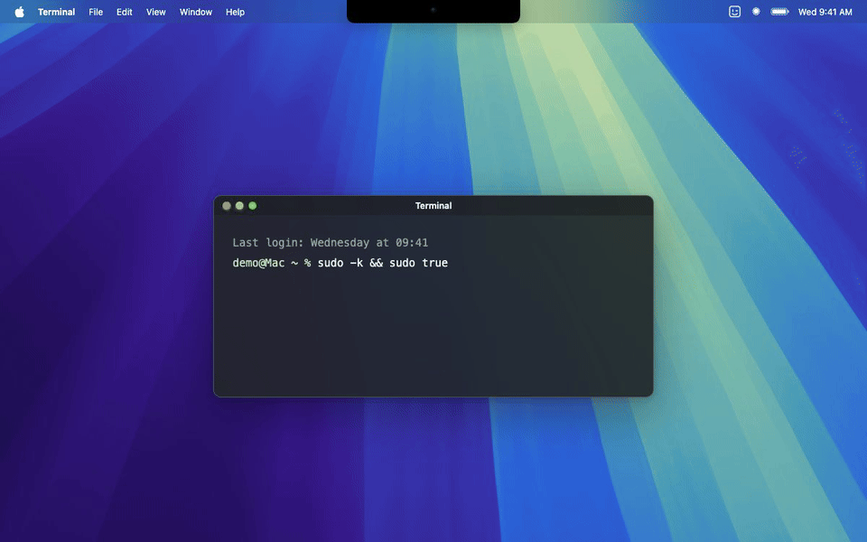
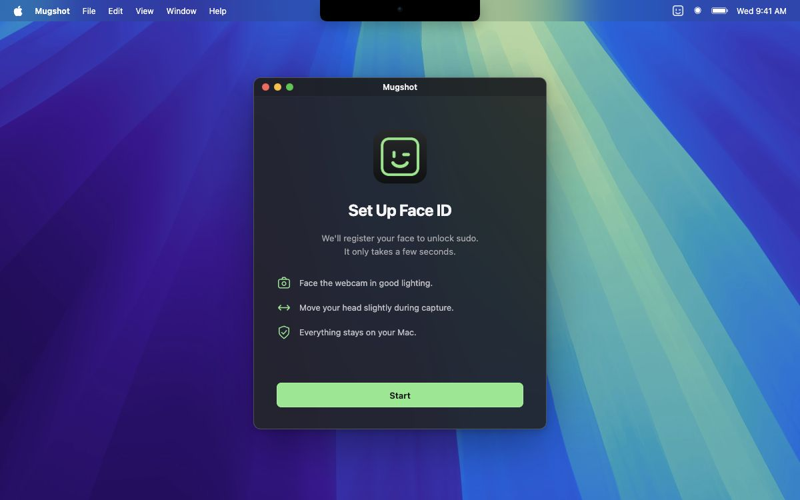
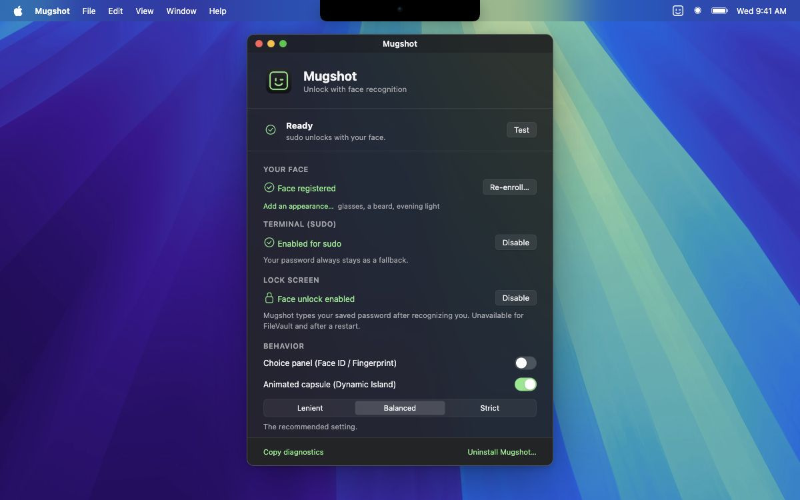
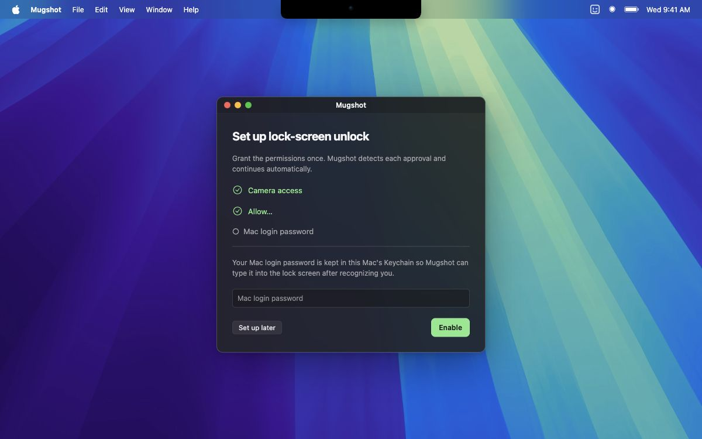
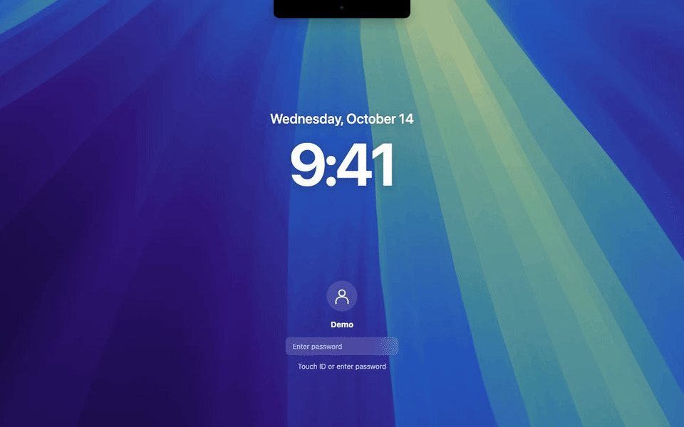
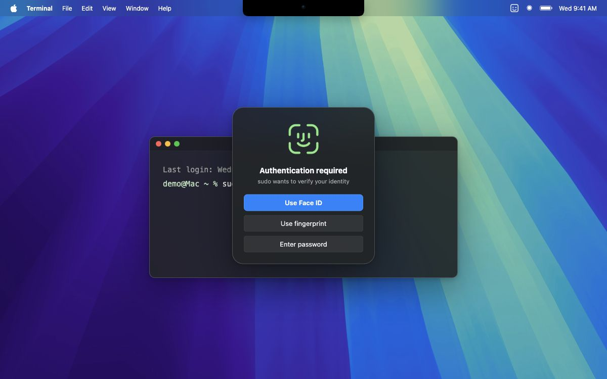
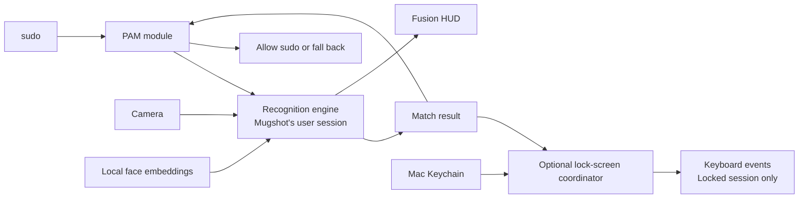

<div align="center">


# Mugshot

**Look at your Mac. Get back to work.**

Face recognition for `sudo` and your locked session. A native macOS menu bar app,
with an animated HUD that unfolds from the camera notch.

[**Download for macOS**](https://github.com/Lorenzo-Coslado/macos-faceid/releases/latest/download/Mugshot.pkg) · [Releases](https://github.com/Lorenzo-Coslado/macos-faceid/releases) · [Report an issue](https://github.com/Lorenzo-Coslado/macos-faceid/issues)


<a href="https://github.com/Lorenzo-Coslado/macos-faceid/actions/workflows/ci.yml"></a>
<a href="LICENSE"></a>

<br><br>


<sub>Interface illustrations based on the current app. [Preview sources and wallpaper credit](docs/VISUALS.md).</sub>

</div>

## Your face, your Mac

Run a `sudo` command, look at the camera, and Mugshot checks your face locally.
The **Fusion** HUD extends the camera notch while scanning, draws a green check
when it recognizes you, then folds away. On displays without a notch, it appears
as a separate capsule beneath the menu bar.

Mugshot also offers optional unlock for an **already logged-in, locked session**.
Enrollment, status, permissions and recognition preferences live in one native window.
You can add another appearance for glasses or different lighting, test recognition,
and choose between a direct scan and an authentication choice panel.

> [!IMPORTANT]
> Mugshot uses an ordinary 2D webcam, which can be fooled by a photo or video.
> It is a convenience project, not Apple's Face ID or a replacement for stronger
> authentication. Your normal password remains the fallback for `sudo`.

## Install and get started

You need an **Apple Silicon Mac running macOS 14 or later** and a built-in or external
webcam. The packaged app includes its recognition engine and models; users do not
need Python, Homebrew or the source checkout.

### 1. Install the package

Download [**Mugshot.pkg**](https://github.com/Lorenzo-Coslado/macos-faceid/releases/latest/download/Mugshot.pkg),
open it and follow the macOS Installer. It places Mugshot in **Applications** and
opens setup in your logged-in session. The installer’s optional **sudo** component
is selected by default; deselect it if you only want to set up the app for now.

Enter the administrator password only in the macOS Installer. This approval installs
system components; it does not save your login password for lock-screen unlock.

Prefer a disk image? [Mugshot.dmg](https://github.com/Lorenzo-Coslado/macos-faceid/releases/latest/download/Mugshot.dmg)
is also available. Drag the app to Applications, then follow the app’s separate
helper and Full Disk Access setup if you want to enable `sudo`.

### 2. Register your face

Allow camera access when macOS asks. The enrollment window guides you through a
short capture. Face the camera in good light and move your head slightly.
Your enrolled face stays on this Mac.



### 3. Check the status and try sudo

If you installed the package with its sudo component, the main window should show
**Ready** after enrollment. Run:

```bash
sudo -k && sudo true
```

Look at the camera while the HUD is open. Recognition allows the command to proceed.
If recognition fails, the engine is unavailable, or you click the HUD to skip the
scan, `sudo` continues to the normal authentication fallback.

Keep Mugshot running: its recognition engine runs as a child of the app.
Quitting Mugshot stops face recognition; it does not remove the sudo configuration.



<details>
<summary>Enable sudo after installing from the disk image</summary>

Click **Enable** in Mugshot. The guided setup asks you to approve the privileged
helper in **System Settings → General → Login Items** and grant the helper
**Full Disk Access** so it can update the protected sudo PAM configuration.
The window checks each approval and continues when it is available.

The package installs the selected sudo component using the system Installer’s
privileges, so this separate helper setup is generally unnecessary at installation.
The app may still need its helper for later configuration changes or uninstallation.

</details>

## Unlock your locked session

After enrollment, setup offers optional lock-screen unlock. You can also open
**Lock Screen → Configure…** in the main window.

1. Allow camera access if it has not already been granted.
2. Enable **Mugshot** in **System Settings → Privacy & Security → Accessibility**.
   The setup window detects the approval and advances automatically.
3. Enter your **Mac login password in Mugshot**, then click **Enable**.
   Mugshot verifies it and stores it in this Mac’s Keychain.



When you lock an existing session, Mugshot can recognize your face and type the saved
password into the lock screen. **It cannot unlock FileVault or perform the first
login after a restart.** This feature is off by default. Disabling it deletes the
saved password.



macOS requires your explicit camera and Accessibility approvals. A download or
installer cannot grant those permissions on your behalf.

## Make it yours

In the main window, you can:

- **Add an appearance** without replacing your existing enrollment.
- Choose **Lenient**, **Balanced** or **Strict** recognition sensitivity.
- Enable or hide the **animated capsule**.
- Enable the **choice panel** to select face recognition, fingerprint or password
  before a sudo scan.
- Select a camera when more than one is available.
- Run a recognition test and copy diagnostics.



## Privacy and security

Recognition runs on your Mac using OpenCV’s **YuNet** face detector and **SFace**
recognition model. Enrolled embeddings and local engine data live in
`~/Library/Application Support/faceid`. Mugshot does not upload camera frames or
face embeddings.

The sudo PAM rule is `sufficient`: a failed match falls through to the remaining
system authentication rules. Optional lock-screen unlock uses a saved login password
and Accessibility keyboard events; it is not an integration with the Secure Enclave.

Read [SECURITY.md](SECURITY.md) for the threat model and private vulnerability reporting.

## Troubleshooting

<details>
<summary><b>Accessibility is enabled, but Mugshot still waits</b></summary>

Use the copy in **Applications** and open its **Configure…** setup. An older build
may have left an authorization tied to a different code signature.

For a stale grant, remove the old Mugshot entry with **−**, completely quit System
Settings, then reopen Accessibility. Add `/Applications/Mugshot.app` with **+** and
enable it. Use **Restart Mugshot and resume** in setup if the process still waits.
Do not rebuild or re-sign the app during this sequence.

Local builds now use a persistent signing certificate. Installing a compatible
rebuild preserves the permission identity. Migrating from an old ad-hoc build requires
fresh consent once; the package clears the incompatible Mugshot camera and
Accessibility entries before opening setup.

</details>

<details>
<summary><b>sudo still asks for a password</b></summary>

Open Mugshot and read the status at the top of its window. Check that your face is
registered and sudo is enabled, then click **Test**. Improve lighting or add an
appearance if recognition misses you. Use **Copy diagnostics** for a support report;
from a checkout, `bash scripts/diagnose.sh` checks the installed components.

</details>

<details>
<summary><b>The app cannot replace the existing copy in Applications</b></summary>

Use the package installer to update an app installed by a package. That copy can be
owned by root, so dragging another app over it may fail. Reopen the updated copy from
Applications after installation.

</details>

<details>
<summary><b>How do I uninstall Mugshot?</b></summary>

Click **Uninstall Mugshot…** at the bottom of the main window. The uninstaller removes
the sudo rule and PAM module, restores the system Touch ID rule, unregisters the helper
and login item, deletes the stored lock-screen password, and offers to remove your
face data and move the app to the Trash.

Dragging the app to the Trash alone leaves its sudo integration behind. If the app’s
helper setup prevents uninstallation, remove that integration from Terminal:

```bash
sudo bash /Applications/Mugshot.app/Contents/Resources/scripts/pam-uninstall-root.sh
```

</details>

## How it works



The app owns the camera request in your login session. A root process such as sudo
asks the engine for recognition through the PAM module rather than trying to access
the camera itself. The lock-screen coordinator separately checks enrollment, feature
settings, password availability, session state and keyboard-event authorization.

## Build from source

<details>
<summary><b>Development, signing and verification</b></summary>

Use macOS 14+ on Apple Silicon, Xcode Command Line Tools and Python 3.12.
For portable release bundles, use the **python.org framework build** rather than a
Homebrew Python compiled for your current macOS version.

```bash
git clone https://github.com/Lorenzo-Coslado/macos-faceid.git
cd macos-faceid
./install.sh
```

This prepares dependencies, downloads models and builds a development package at
`build/Mugshot-dev.pkg`. **Open that package to install**; the script stages the app
rather than overwriting the running copy in Applications.

For a self-contained local app and package:

```bash
./scripts/build-standalone.sh
ALLOW_UNSIGNED_PKG=1 ./scripts/build-pkg.sh dist/Mugshot.app dist/Mugshot-local.pkg
```

Local builds use a persistent certificate in a dedicated keychain under
`~/Library/Application Support/Mugshot/Signing`. Keep that directory outside the
checkout. Initialization may ask for native administrator approval to trust the
certificate for code signing. If its identity is missing, restore it; builds refuse
to silently generate a replacement or use `LOCAL_SIGN_IDENTITY=-`.

An explicit `LOCAL_SIGN_IDENTITY` can select an existing signing certificate. Keep
that identity stable between builds. The package compares the old and new designated
requirements, verifies the installed payload and opens that exact app for setup.
`ALLOW_UNSIGNED_PKG=1` permits local test packaging; it does not notarize the app or
make the local certificate suitable for distribution to other Macs.

The public release pipeline requires **Developer ID Application**, **Developer ID
Installer**, and a `notarytool` profile (default: `faceid-notary`):

```bash
MARKETING_VERSION=1.2.0 BUILD_VERSION=9 ./scripts/build-release.sh
```

It signs the app, notarizes and staples the artifacts, and produces release packages
and disk images. Set `MARKETING_VERSION` and `BUILD_VERSION` for the candidate.
Use the same Developer ID team across releases. `BUILD_PKG=0` skips
the package. See the script headers for signing and notarization options.
The release build installs `requirements-build.txt` for headless DMG layout.
See [the release procedure](docs/RELEASE.md) for verification, draft preparation,
resuming notarization and the final public publication step.

Relevant checks:

```bash
.venv/bin/python -m faceid.selftest
.venv/bin/python tests/test_engine.py
bash scripts/check-lock-screen-setup.sh
python3 tests/test_signing_identity.py
bash scripts/check-i18n.sh
```

The signing tests reproduce the old ad-hoc identity mismatch, confirm that different
builds with the persistent certificate remain compatible, and reject unsigned
resource changes. Permission tests use fixtures; they do not replace verification
on an installed app.

</details>

## Visual previews

The README assets come from a reusable [preview](docs/preview/index.html) with six
scenes, a real macOS Sequoia wallpaper, deterministic animation frames and controls
for scan, recognition, fallback and displays without a notch.

See [docs/VISUALS.md](docs/VISUALS.md) to run it locally and regenerate the stills and
GIFs. These are interface illustrations, not recordings of real authentication.

## Contributing and credits

Issues and pull requests are welcome. See [CONTRIBUTING.md](CONTRIBUTING.md) and the
[Code of Conduct](CODE_OF_CONDUCT.md).

Built with Swift, SwiftUI, OpenCV and the [YuNet and SFace models](https://github.com/opencv/opencv_zoo).
Wallpaper attribution and visual asset sources are documented in [docs/VISUALS.md](docs/VISUALS.md).
Mugshot is independent of Apple.

Code is licensed under [MIT](LICENSE). Third-party artwork retains its own rights.
